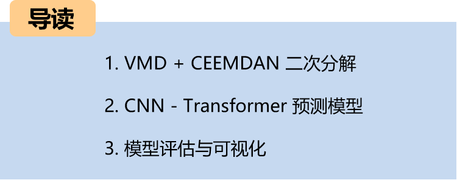
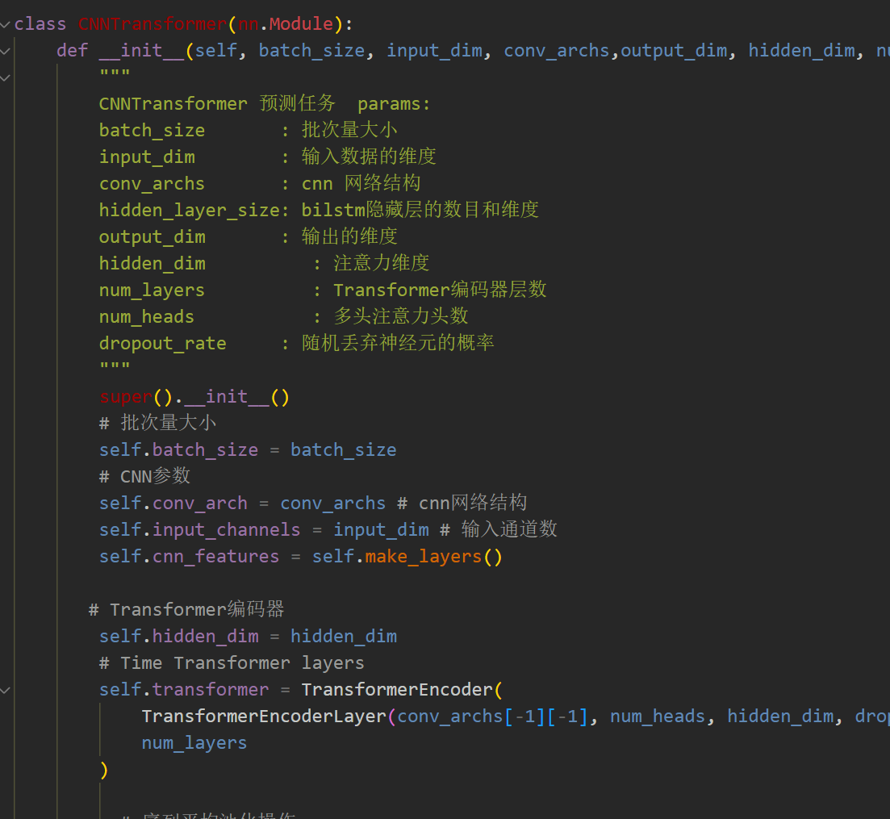
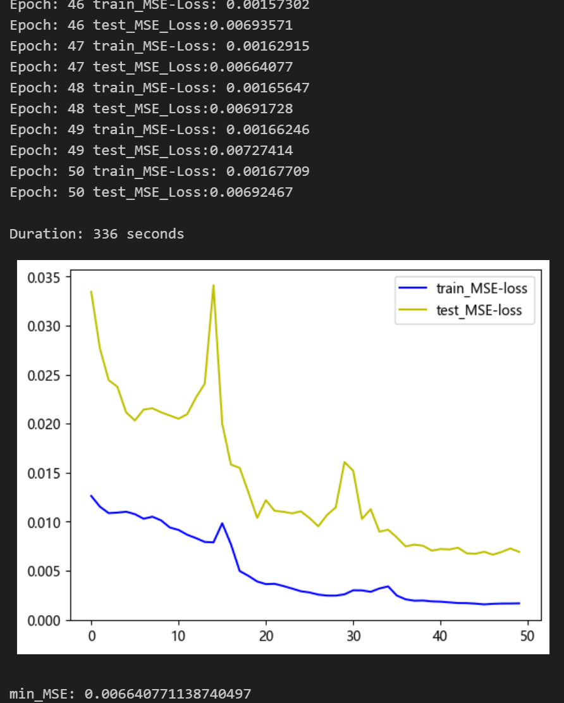
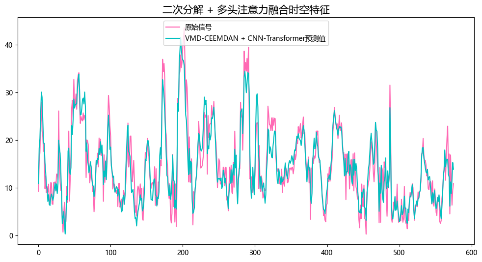
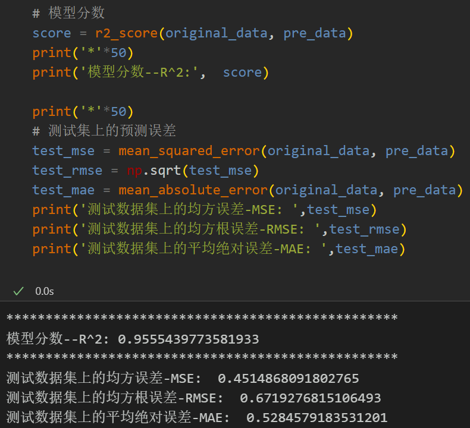
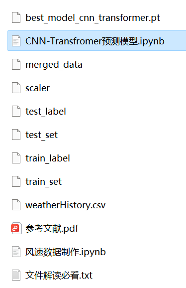

# VMD+CEEMDAN Second Decomposition, CNN-Transformer Prediction Model

Innovation Point: Secondary decomposition + Multi-head Attention for fusion of spatiotemporal features
Including wind speed data, as well as the already generated and prepared wind speed dataset and label set, corresponding codes can be run.
VMD + CEEMDAN secondary decomposition, CNN-Transformer prediction model, with smaller MSE and MAE, the effect is particularly obvious, significantly improved!
Includes data preprocessing and secondary decomposition code, as well as complete CNN-Transformer model prediction and visualization code.
Innovation Point: Secondary decomposition + Multi-head Attention for fusion of spatiotemporal features
Preface
This article, based on the preliminary introduction of wind speed data (data set attached at the end), introduces a CNN-Transformer prediction model based on VMD+CEEMDAN secondary decomposition to enhance the predictive performance of time series data. For a detailed introduction to the wind speed dataset, please refer to the following text:
Wind Speed Prediction (Part 1) Data Set Introduction and Preprocessing
1. Secondary decomposition and dataset creation
1.1 Import data
1.2 VMD Decomposition
Step 1: Observe the center frequency under different K values, select the K value; starting from K=4, there are modes with similar center frequencies, indicating overdecomposition. Therefore, the number of modes K is set to 4.
\t  
Step two, decomposition of visualization
\t1.3 Sample Entropy
Sample entropy is a method used to measure the complexity of sequences, which can be evaluated by calculating the uncertainty in the sequence. The higher the sample entropy, the greater the complexity of the sequence.
Through the calculation of sample entropy from four components decomposed by VMD, the residual item IMF4 has richer uncontrollable information. To further extract the effective information in IMF4, CEEMDAN decomposition is conducted on the residual item IMF4 of VMD.
\t  
\t1.4 CEEMDAN decomposition
Re-decompose the last residual component extracted from VMD.
1.5 Dataset Preparation
\tFirstly, merge the components of VMD and CEEMDAN decomposition, and divide the training set and test set according to 8:2.
When dealing with LSTF issues, selecting the appropriate window size is crucial. The right choice of window size can help the model better capture patterns and features within time series. To extract longer dependencies in the sequence, this paper has increased the window size to 48 and employed a CNN-Transformer model to fully extract spatiotemporal feature information from the component sequences.
2. CNN-Transformer Prediction Model Based on Pytorch
2.1 Define the CNN-Transformer prediction model
\tNote: The input wind speed data has a shape of [64, 48, 14], where batch_size=64. The numbers 64 and 48 represent the sequence length (the values are taken from a sliding window), and the dimensionality of 14 represents the dimensions of the merged components.
\t  
2.2 Set parameters and train the model
50 epochs, MSE is 0.00290. The CNN-Transformer model with VMD+CEEMDAN secondary decomposition shows good predictive performance. After the secondary decomposition, more information can be extracted from the sequence. The CNN-Transformer model can extract the spatiotemporal information of the components, and the prediction effect is significantly improved. With appropriate adjustment of model parameters, further improvement in model prediction performance can be achieved.
\tNote: Adjust parameters.
\tThe number of CNN layers and the dimension per layer can be modified.
Adjust the number of Transformer encoder layers and attention dimensions, as well as the number of multi-head attention heads, to increase more epochs (be cautious to prevent overfitting).
\tThe sliding window length can be changed (set the appropriate window length).
3. Model Evaluation and Visualization
3.1 Results Visualization
3.2 Model Evaluation
Previously Featured Content:
Time series forecasting: Analysis and comparison of LSTM, ARIMA, Holt-Winters, SARIMA models
Wind speed prediction (I) Data introduction and preprocessing
Wind speed prediction (II) EMD-LSTM model based on Pytorch
Wind speed prediction (III) EMD-LSTM-Attention model
Wind speed prediction (IV) EMD-Transformer model based on Pytorch
Wind speed prediction (V) EMD-CNN-LSTM model based on Pytorch
Wind speed prediction (VI) EMD-CNN-GRU parallel model based on Pytorch
Wind speed prediction (VII) VMD-CNN-BiLSTM prediction model
CEEMDAN + combined prediction model (BiLSTM-Attention + ARIMA)
CEEMDAN + combined prediction model (CNN-LSTM + ARIMA)
CEEMDAN + combined prediction model (Transformer - BiLSTM + ARIMA)
CEEMDAN + combined prediction model (CNN-Transformer + ARIMA)
Multi-feature variable sequence prediction (I) - CNN-LSTM wind speed prediction model
Multi-feature variable sequence prediction (II) - CNN-LSTM-Attention wind speed prediction model
Multi-feature variable sequence prediction (III) - CNN-Transformer wind speed prediction model
Multi-feature variable sequence prediction (IV) Transformer-BiLSTM wind speed prediction model
Multi-feature variable sequence prediction (V) CEEMDAN+CNN-LSTM wind speed prediction model
Multi-feature variable sequence prediction (VI) CEEMDAN+CNN-Transformer wind speed prediction model
Predictive Model Based on the Particle Swarm Optimization Algorithm (SSA) for CEEMDAN-BiLSTM-Attention
Predictive Model Based on the Particle Swarm Optimization Algorithm (SSA) for CEEMDAN-Transformer-BiGRU
Superior Predictive Model: Secondary Decomposition-Combination Prediction
Multi-Feature Variable Sequence Prediction (Part 7): CEEMDAN+Transformer-BiLSTM Prediction Model
Multi-Feature Variable Sequence Prediction (Part 8): CEEMDAN-SSA-BiLSTM Prediction Model Based on the Particle Swarm Optimization Algorithm
Multi-Feature Variable Sequence Prediction (Part 9): CEEMDAN-SSA-BiGRU-Attention Prediction Model Based on the Particle Swarm Optimization Algorithm
Multi-Feature Variable Sequence Prediction (Part 10): CEEMDAN-SSA-Transformer-BiLSTM Prediction Model Based on the Particle Swarm Optimization Algorithm
VMD + CEEMDAN: Secondary Decomposition, BiLSTM-Attention Prediction Model

## Images

<!-- PAYMENT_BLOCK -->

## Get this dataset

- Payment link (Stripe): [Buy now](https://buy.stripe.com/3cs8yP7sY87d0vu9AB)
- Payment QR code: 

<!-- /PAYMENT_BLOCK -->
